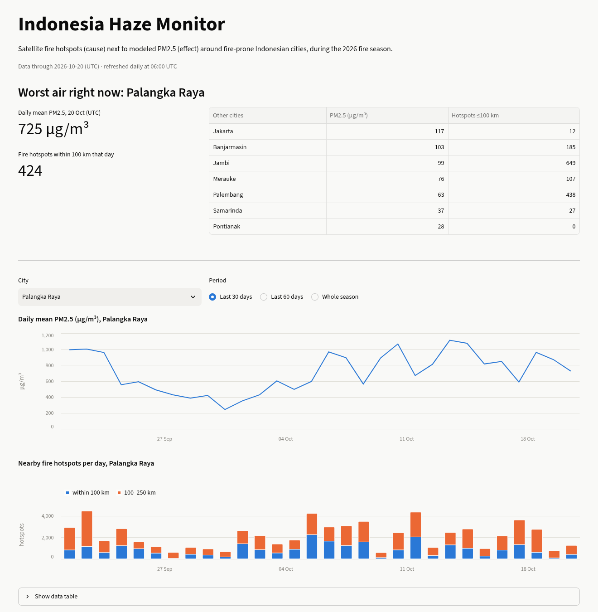
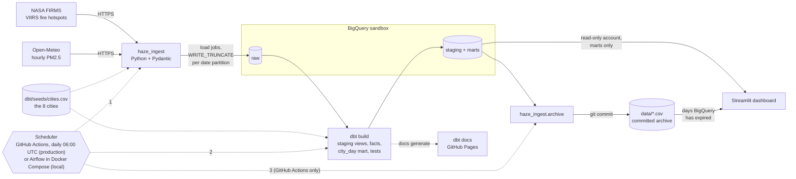
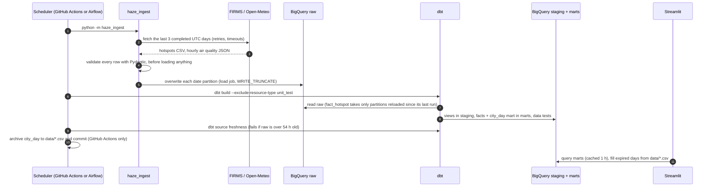
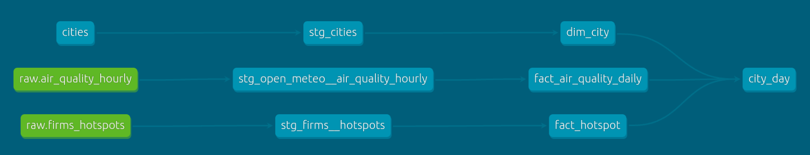

# Indonesia Haze Monitor

An automated data pipeline that links **satellite fire hotspots** (the cause) to **modeled PM2.5 air pollution** (the effect) around eight fire-prone Indonesian cities, refreshed daily and served on a public dashboard.

**[Live dashboard](https://indonesia-haze-monitor-eyqyj2ahkqgdob7qrk8nxb.streamlit.app/)** · **[dbt docs and lineage](https://habilmb.github.io/indonesia-haze-monitor/)** · [Season archive (CSV)](data/)

[](https://github.com/HabilMB/indonesia-haze-monitor/actions/workflows/ci.yml)
[](https://github.com/HabilMB/indonesia-haze-monitor/actions/workflows/refresh.yml)
[](https://github.com/HabilMB/indonesia-haze-monitor/actions/workflows/docs.yml)



Every dry season, peat and forest fires in Kalimantan, Sumatra and Papua blanket nearby cities in smoke. This project pulls NASA's satellite fire detections and a modeled air-quality feed each day, joins them geographically in BigQuery with dbt, and shows, per city, how many fires burned within 100 and 250 km next to that day's PM2.5.

| | |
|---|---|
| **Sources** | NASA FIRMS (VIIRS hotspots, ~7k detections/day over Indonesia), Open-Meteo Air Quality (hourly PM2.5 from CAMS) |
| **Stack** | Python + Pydantic, BigQuery, dbt, Airflow, Docker Compose, GitHub Actions, Streamlit |
| **Cities** | Palangka Raya, Pontianak, Banjarmasin, Samarinda, Palembang, Jambi, Merauke, and Jakarta as a low-fire comparison |
| **Cost** | $0: BigQuery sandbox (no billing account), Streamlit Community Cloud, GitHub Actions and Pages |

## How the pieces connect



A daily run, end to end:



How each connection is made, and with which credentials:

| From → To | How | Credentials |
|---|---|---|
| Ingestion → FIRMS | HTTPS GET to the area CSV API, 3 retries with backoff, 10 s / 60 s timeouts | `FIRMS_MAP_KEY` (env var; kept out of logs) |
| Ingestion → Open-Meteo | HTTPS GET, one request per city | none (CC BY 4.0) |
| Ingestion → BigQuery `raw` | `google-cloud-bigquery` load jobs on partition decorators (`table$20261020`) | `haze-loader` service account |
| dbt → BigQuery `staging`/`marts` | dbt-bigquery, service-account keyfile from `GOOGLE_APPLICATION_CREDENTIALS` | `haze-loader` |
| GitHub Actions → everything above | runs the CLI and dbt on an Ubuntu runner; the key is written to a temp file and deleted after | repo secrets `GCP_SA_KEY`, `FIRMS_MAP_KEY`, `GCP_PROJECT_ID` |
| Airflow → everything above | three `BashOperator`s in the scheduler container, calling a separate pipeline virtualenv | `.env` + `secrets/loader-sa.json` mounted read-only |
| Dashboard → BigQuery `marts` | `google-cloud-bigquery` queries, cached for an hour | `haze-dashboard`: read-only on `marts`, nothing else |
| Dashboard → `data/*.csv` | reads the committed archive for days BigQuery has already expired | none (public repo) |
| dbt docs → GitHub Pages | `dbt docs generate --static`, deployed by `docs.yml` | `haze-loader` (read-only use) |

Two service accounts keep the public side harmless. The dashboard's account can read only the `marts` dataset (verified: reading `raw` and creating tables are both denied). The loader's account can write, but it lives only in GitHub secrets and the local `.env`. `dbt/seeds/cities.csv` is the single list of cities: ingestion reads it to know where to request air quality, and dbt seeds it into `dim_city`.

## The data model



| Model | Grain | Notes |
|---|---|---|
| `stg_firms__hotspots` | one detection | Hashes a `hotspot_id` from satellite, position and time; builds `acquired_at`; maps confidence `l/n/h` to `low/nominal/high`; keeps one row per re-served detection |
| `stg_open_meteo__air_quality_hourly` | city × hour | |
| `dim_city` | city | From the seed |
| `fact_hotspot` | one detection | Incremental. Replaces only the date partitions whose raw load is newer, using copy jobs (see design decisions) |
| `fact_air_quality_daily` | city × UTC day | Mean and peak PM2.5, peak US AQI, hours observed |
| `city_day` | city × UTC day | The mart: PM2.5 plus counts of nominal/high-confidence hotspots within 100 and 250 km (`ST_DWITHIN`) |

Tests run on every build: `unique` and `not_null` keys, `accepted_values` on confidence, PM2.5 range checks, `relationships` to `dim_city`, a check that the 100 km count never exceeds the 250 km count, and source freshness on `raw`. Six dbt unit tests pin the trickiest logic: the incremental partition selection (including a half-finished reload and clock skew), null hours, and the hotspot rings.

## What the data shows

Monthly means from [`data/city_day_monthly.csv`](data/city_day_monthly.csv) (2026-08-22 to 2026-10-19):

| City | Aug | Sep | Oct | Hotspots within 100 km, season |
|---|---:|---:|---:|---:|
| Palangka Raya | 174 | 465 | 768 | 56,335 |
| Jambi | 52 | 68 | 124 | 9,233 |
| Jakarta | 86 | 89 | 109 | 545 |
| Palembang | 53 | 58 | 108 | 23,255 |
| Banjarmasin | 20 | 61 | 64 | 35,433 |
| Pontianak | 114 | 91 | 63 | 5,301 |
| Merauke | 25 | 29 | 52 | 18,250 |
| Samarinda | 16 | 25 | 37 | 5,008 |

Mean daily PM2.5 in µg/m³ (modeled; the WHO 24-hour guideline is 15). August covers its last 10 days, October its first 19.

Palangka Raya, in the middle of Central Kalimantan's peatlands, has by far the most fires within 100 km and the worst modeled air in every month. Jakarta is the useful counterexample: it has very few fires nearby and still sits around 90–110 µg/m³, a reminder that urban emissions and transported smoke both matter. That is why the dashboard says "next to", not "caused by".

## Design decisions

- **Built around the BigQuery sandbox's limits.** The free sandbox has no DML (`INSERT`/`MERGE`/`DELETE`), a 60-day expiry on partitions, and 10 GiB of lifetime storage.
  - Ingestion loads each date partition with a load job and `WRITE_TRUNCATE`.
  - The incremental `fact_hotspot` uses dbt's `insert_overwrite` with `copy_partitions: true`, so partitions are swapped with copy jobs and not `MERGE`. I spike-tested that in the sandbox before building on it.
  - `fact_hotspot` (~500k rows per 60 days) is never fully rebuilt daily; only the small `city_day` mart is.
- **Idempotent reruns.** Every run re-pulls the last 3 completed UTC days. That picks up late satellite detections, and running the same day twice replaces data instead of duplicating it. That is also what makes Airflow retries safe.
- **Validate everything before writing anything.** Ingestion fetches and validates both sources (Pydantic models) for the whole window before the first load, so a bad API response never leaves a half-loaded day.
- **Per-partition freshness instead of a global high-water mark.** `fact_hotspot` compares `ingested_at` per date partition, so a run that failed part-way, two overlapping runs, or a runner with a skewed clock all heal on the next run. Each case has a dbt unit test.
- **The season outlives the 60-day expiry.** The daily refresh exports `city_day` to [`data/`](data/) and commits it. The dashboard merges those rows with BigQuery's, so the September peak stays visible after BigQuery drops it.
- **Two schedulers, one writer.** Airflow is what you would run on a real platform; GitHub Actions keeps the free demo alive. Both call the same CLI commands, so neither holds pipeline logic. The Airflow DAG starts paused, so the two never write production at the same time.
- **Airflow without dependency fights.** The Airflow image installs the pipeline into its own virtualenv, so Airflow's pinned constraints and dbt's dependencies never have to agree.
- **UTC everywhere.** FIRMS reports in UTC and satellite overpasses straddle local midnight, so "a day" is a UTC day in every table and chart, and the dashboard says so.
- **No dual-axis charts.** PM2.5 and hotspot counts are two stacked charts on the same date axis, so neither scale can be tuned to suggest a correlation.
- **Secrets stay out of the repo and the logs.** Keys live in `.env`, `secrets/` (both gitignored) and the GitHub and Streamlit secret stores. The FIRMS key sits in the request URL, so the HTTP library's retry logging is silenced, and error messages strip it.

## Run it yourself

Viewing the results needs nothing but the links at the top. Running the pipeline needs a free [NASA FIRMS map key](https://firms.modaps.eosdis.nasa.gov/api/map_key/) and a Google Cloud project (the BigQuery sandbox works; no billing account).

**1. Google Cloud setup**

```bash
export GCP_PROJECT_ID=your-project-id
for ds in raw staging marts; do bq --location=asia-southeast2 mk -d "$GCP_PROJECT_ID:$ds"; done
```

Create two service accounts: a loader (BigQuery Job User on the project, Data Editor on the three datasets) and a dashboard reader (Job User, Data Viewer on `marts` only). Save their JSON keys as `secrets/loader-sa.json` and `secrets/dashboard-sa.json` (gitignored), with `chmod 600`.

**2. Configure and install** (Python 3.12)

```bash
cp .env.example .env          # fill in FIRMS_MAP_KEY and GCP_PROJECT_ID
python3.12 -m venv .venv
.venv/bin/pip install -r ingestion/requirements-dev.txt -r dbt/requirements.txt -r dashboard/requirements.txt
set -a; . ./.env; set +a
export PYTHONPATH=ingestion
```

**3. Run the pipeline**

```bash
python -m haze_ingest --start 2026-09-01 --end 2026-09-30   # backfill, up to 59 days back
python -m haze_ingest                                       # or the default: last 3 completed UTC days
dbt build --exclude-resource-type unit_test --project-dir dbt --profiles-dir dbt
dbt source freshness --project-dir dbt --profiles-dir dbt
```

**4. Run the dashboard**

```bash
GOOGLE_APPLICATION_CREDENTIALS=secrets/dashboard-sa.json streamlit run dashboard/app.py
```

**5. Or run it all under Airflow**

Set the four `AIRFLOW_*` values in `.env`; see `.env.example`, and generate the secrets with `openssl rand -hex`. Then:

```bash
docker compose up -d --build
```

Open <http://127.0.0.1:8080> and log in as `admin` with `AIRFLOW_ADMIN_PASSWORD`. Then unpause `haze_pipeline`, which starts the latest 06:00 run immediately. Pause it again if GitHub Actions is your production scheduler. Compose starts Postgres, the API server/UI, the scheduler (LocalExecutor) and the DAG processor; the UI is bound to localhost only.

**Tests**

```bash
python -m pytest ingestion            # ingestion: API parsing, validation, load windows, CLI errors
python -m pytest dashboard            # data shaping + Streamlit AppTest smoke tests
dbt build --project-dir dbt --profiles-dir dbt   # includes the dbt unit tests
```

CI (`.github/workflows/ci.yml`) runs pytest, `dbt parse` and the Airflow DAG integrity test on every pull request, without any credentials.

## Caveats

- **Modeled, not measured.** PM2.5 comes from the CAMS model on a coarse grid. Pontianak's coordinates, for example, resolve to the grid point at 0.0, 109.3. Absolute values can be far from what a ground sensor would read.
- **Hotspots are not confirmed fires.** They are satellite thermal detections. Only nominal- and high-confidence detections are counted.
- **Correlation, not causation.** Wind carries smoke hundreds of kilometres, and cities have their own emissions. Fire counts within a radius ignore wind direction.
- **A rolling window.** The sandbox keeps 60 days, so the live charts are always the most recent ~60 days; older days come from the committed archive.
- **Free-tier behaviour.** The Streamlit app sleeps after inactivity, so the first load can take a few seconds. GitHub disables scheduled workflows in public repos after 60 days without commits; the daily archive commit keeps this one active.

## What I'd improve

- **Workload Identity Federation instead of a service-account key** for GitHub Actions, so no long-lived key exists anywhere.
- **Ground truth:** compare the modeled PM2.5 with KLHK ISPU ground stations (no public API found yet).
- **Wind-aware attribution:** weight hotspots by whether the wind blew from them towards the city, using ERA5 or Open-Meteo wind data.
- **Science-quality hotspots:** switch FIRMS NRT for the reprocessed standard product once it is published (about 2–3 months later).
- **Edge cases noted during review:**
  - If a re-pull finds no hotspots for a day, the raw partition is cleared, but `fact_hotspot` keeps that day's old rows until a `--full-refresh`.
  - A city-day missing from the air-quality feed drops out of `city_day`, instead of appearing with a null PM2.5.
- **Separate CI datasets**, so pull requests can run a full `dbt build` instead of `dbt parse` without touching production.
- **Terraform** for the datasets, service accounts and IAM, which are currently set up by hand.

## Repository layout

```
ingestion/haze_ingest/   FIRMS + Open-Meteo clients, Pydantic models, BigQuery loader, CLI, CSV archive
dbt/                     sources, staging views, marts, seeds, data + unit tests
airflow/                 DAG, Dockerfile (Airflow 3.3.2 + pipeline venv), DAG tests
dashboard/               Streamlit app, BigQuery loaders, data shaping, tests
data/                    daily + monthly city_day archive, committed by the refresh workflow
.github/workflows/       ci.yml, refresh.yml (daily), docs.yml (dbt docs → Pages)
docker-compose.yml       local Airflow: Postgres, API server, scheduler, DAG processor
```

## Data and attribution

- Fire data: NASA FIRMS, VIIRS S-NPP 375 m NRT active fire product (LANCE/FIRMS, NASA EOSDIS).
- Air quality: [Open-Meteo](https://open-meteo.com/) Air Quality API (CC BY 4.0), based on Copernicus Atmosphere Monitoring Service (CAMS) forecasts.
